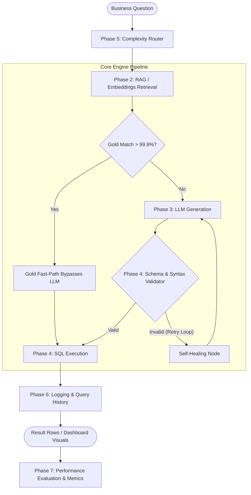

# 🧠 NLPSQL — Autonomous Local NL2SQL Production Pipeline

An **offline-first, production-grade Natural Language to SQL (NL2SQL)** conversion engine. This system leverages a local Large Language Model (Ollama), semantic vector searches (psycopg2 + pgvector), strict schema compilation safeguards, database-compiler guided self-healing, and a dual-interface delivery system (FastAPI API + Streamlit Dashboard).

## Strict Offline Contract

The runtime does not require hosted AI APIs or API keys. With `OFFLINE_MODE=true`:

* Ollama must use a loopback URL such as `http://127.0.0.1:11434`.
* Embedding models must already exist on disk; Hugging Face downloads are blocked.
* The dashboard uses system fonts and does not fetch Google Fonts.
* PostgreSQL, pgvector, Ollama, embedding inference, reranking, validation, and query execution remain local.

The agent is intentionally scoped to analytics questions supported by the loaded datasets and business rules. Broad coverage is built by expanding deterministic plans, reusable query patterns, semantic checks, and gold evaluation cases. Unsupported or ambiguous questions should fail clearly instead of inventing an answer.

Run the generated dataset-driven coverage benchmark after changing business logic:

```bash
python benchmark_coverage.py --execute-limit 5000
```

This generates thousands of questions from the current local database values, checks deterministic routing and semantic coverage, executes the requested sample locally, and writes `data/coverage_report.json`.

---

## 🏗️ 7-Phase Modular Architecture

The core of the system is split into **7 distinct, modular execution phases** located in the [core/](core/) directory. This design separates the pipeline steps into testable, resilient components.



### 📋 Phase Details

*   **[Phase 1: Ingestion](core/phase1_ingestion.py)**: Scans raw CSV files (like M60_LEVEL, MOM_LEVEL, Industry Performance), generates precise types, key constraints, null ratios, sample distributions, and writes the source-of-truth schema catalog (`data/schema_metadata.json`).
*   **[Phase 2: Embeddings](core/phase2_embeddings.py)**: Manages local vector searches using `pgvector`. It generates vector embeddings of database schema fields and few-shot pairs to serve as highly relevant RAG context.
*   **[Phase 3: LLM Core](core/phase3_llm_core.py)**: Communicates with local LLM weights (e.g. `qwen2.5-coder:7b`) to synthesize SQL based on user prompts. Houses the critical SQL self-healing script.
*   **[Phase 4: Validator](core/phase4_validator.py)**: Ensures database safety. Performs syntax checks, verifies table/column structures, runs non-destructive `EXPLAIN` query plans, and triggers the LLM-repair loop when database errors arise.
*   **[Phase 5: Router](core/phase5_router.py)**: Classifies the complexity of incoming questions, dynamically scaling the prompt size and few-shot details to fit the query difficulty.
*   **[Phase 6: Orchestrator](core/phase6_orchestrator.py)**: Connects all phases into a unified run-loop. Incorporates the **Gold Fast-Path** which bypasses LLMs entirely to run highly repetitive business queries in under `0.1 seconds`.
*   **[Phase 7: Evaluation](core/phase7_evaluation.py)**: A standalone benchmarking environment that calculates model speed, precision, and accuracy, generating training datasets for offline fine-tuning.

---

## 💎 Advanced Engineering Capabilities

1.  **🚀 Gold Fast-Path**: If a user’s plain-English question matches a pre-verified template in pgvector memory at a `98%+ similarity score`, the system runs the query directly. This provides near-instant response times for frequent analytics.
2.  **⚕️ Compiler-Guided Self-Healing**: If the LLM generates SQL with minor compilation errors, Phase 4 traps the raw PostgreSQL exception (e.g., column mismatches, missing joins) and directs Phase 3 to fix it. The pipeline automatically recovers and reruns the healed SQL without interrupting the user.
3.  **📡 Real-Time SSE Log Streaming**: The FastAPI backend includes a Server-Sent Events stream that captures standard console stdout thread-safely, providing a live stream of the AI's complex reasoning and logs directly in the UI.

---

## 🚀 Setup & Installation Guide

### 1. Prerequisites
Ensure you have the following installed on your machine:
*   **Python**: Version 3.10 or higher.
*   **PostgreSQL**: Built with the **`pgvector`** extension active.
*   **Ollama**: Download and install from [ollama.com](https://ollama.com).

### 2. Configure Local LLM (Ollama)
Initialize the Ollama background engine and pull the primary code model:
```bash
# Start the Ollama server
ollama serve

# In a new terminal, download the Qwen coder weights
ollama pull qwen2.5-coder:7b
```

### 3. Clone & Environment Settings
Create a Python virtual environment and configure your database parameters in `.env`:
```bash
# Create and activate virtual environment
python -m venv venv
source venv/bin/activate  # On macOS/Linux
# venv\Scripts\activate   # On Windows

# Install all system dependencies
pip install -r requirements.txt
```

Verify your `.env` connection variables conform to your local PostgreSQL instance:
```env
DB_HOST=localhost
DB_PORT=5432
DB_NAME=postgres
DB_USER=postgres
DB_PASSWORD=your_secure_password
OFFLINE_MODE=true
OLLAMA_BASE_URL=http://127.0.0.1:11434
```

### 4. Initialize Database & Vector Memory
Run these setup scripts sequentially to populate tables, generate metadata, and embed RAG libraries:
```bash
# 1. Initialize PostgreSQL schema tables and load CSV rows
python setup_db.py

# 2. Extract database schema metadata to JSON
python generate_metadata.py

# 3. Setup pgvector structures and embed column schemas
python setup_vector_store.py

# 4. Load the few-shot learning query templates
python load_examples.py
```

---

## 🔌 Running the System

### 💻 Option A: Interactive Streamlit UI
A premium dark-themed dashboard equipped with real-time query builders, execution metrics, live database schema explorers, history logs, and benchmark panels:
```bash
streamlit run app.py
```
*(Access in your web browser at `http://localhost:8501`)*

On macOS, you can also run `./launch.command` from the project directory.

### 🔌 Option B: Headless FastAPI Backend Web Server
A REST-API service equipped with streaming Server-Sent Events endpoints for live log parsing:
```bash
python main.py
```
*(API docs available at `http://localhost:8000/docs`)*

---

## 📁 Directory Architecture

```markdown
├── 📁 core/                    # Core 7-Phase Execution Engine
│   ├── phase1_ingestion.py     # Schema ingestion and analysis
│   ├── phase2_embeddings.py    # Local pgvector searches and embeddings
│   ├── phase3_llm_core.py      # LLM inference configurations and self-healing
│   ├── phase4_validator.py     # Syntax safeguards and DB execution
│   ├── phase5_router.py        # Question complexity routing
│   ├── phase6_orchestrator.py  # Production orchestration & Gold Fast-Path
│   └── phase7_evaluation.py    # Standalone quality benchmarking
├── 📁 data/                    # Generated system catalogs
│   └── schema_metadata.json    # Global database schema registry
├── app.py                      # Interactive Streamlit UI Dashboard
├── main.py                     # FastAPI Backend API Server
├── config.py                   # Central system configuration
├── requirements.txt            # System dependencies manifest
├── schema.sql                  # Primary PostgreSQL tables structure
└── seed_pairs.json             # Seed examples for RAG few-shot learning
```
